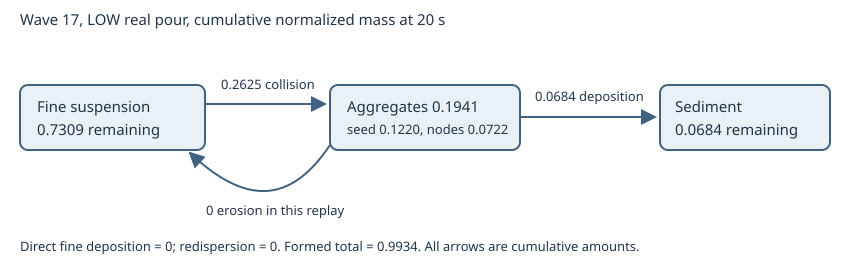

# Wave 17 F1b: AgCl mass transfer and settling

## Scope and finding

The deterministic real-pour harness runs 400 fixed 50 ms steps on both real grids. [The complete LOW and HIGH histories](low-pour-transfers.csv), [the no-jet control](low-still-transfers.csv), [sampled diagnostics](replay.json), and [the transfer diagram](transfers.svg) are numeric results, not browser observations. The current model is an experimental alternative behind `__silverAgg`; `__silverJetModel` and `__silverSubgrid` remain off. The pre-change comparison is the `7690e47` code in [baseline/replay.json](baseline/replay.json).

The old model's **fine-to-aggregate conversion was the main cause of early depletion**. By 6 s it had transferred 0.975 normalized units from fine to aggregate, although only 0.744 had formed; 0.362 had already eroded and been converted again. Aggregate-to-sediment transfer was also fast (0.270 by 6 s), but direct fine deposition and redispersion were exactly zero. At 14 s, cumulative fine-to-aggregate was 1.665, erosion 0.871, and aggregate-to-sediment 0.638. Its 2.68 mm/s mean slip at 14 s and fast floor transfer compounded the initial conversion. The node/floor boundary is not the main source: it deposits only resting nodes, and the old model already had a large aggregate supply well before the node cap. Sediment mass is stored exactly by `deposit`; the old height conversion was a separate volume/appearance error, not a lost-mass error.

The revised model's new limiting mechanism is **representation capacity**. At 20 s LOW, 0.1220 of 0.1941 aggregate mass is conserved in advected sub-resolution seeds because nodes reach the fixed 260 cap. Contact merging of approaching, unlinked nodes lowered that seed reservoir from 0.1499 before the merge change. It has not solved the cap. In particular, these seeds are transported with the fine carrier settings and do not have their own size-dependent slip. This remains an important physical and visual limitation. No pending parcel was lost: the FlocSystem pending list stays empty and seed mass is included in `denseMass`, `aggregateTexture`, and the ledger.

## Material-transfer graph and measurements

All figures are normalized AgCl amounts. `fine` includes the suspension classes and coarse legacy field; in stage 3, only the primary suspension class carries appreciable mass. The table is the LOW real pour. Formed mass differs slightly between versions because aggregate loading feeds back into resolved flow and reactant contact.

| s | old fine | old aggregate | old sediment | revised fine | revised aggregate | revised sediment | revised seed within aggregate |
|---:|---:|---:|---:|---:|---:|---:|---:|
| 1 | .0355 | .1245 | .0119 | .1580 | .0072 | .0000 | .0029 |
| 3 | .0843 | .3147 | .0685 | .3723 | .0439 | .0001 | .0101 |
| 6 | .1311 | .3437 | .2695 | .5564 | .0878 | .0132 | .0364 |
| 9 | .1545 | .2794 | .4469 | .6534 | .1174 | .0320 | .0628 |
| 14 | .1780 | .1555 | .6376 | .7327 | .1654 | .0483 | .0990 |
| 20 | .2006 | .0512 | .7433 | .7309 | .1941 | .0684 | .1220 |

| s | revised fine to aggregate, cumulative | aggregate to sediment, cumulative | aggregate to fine | direct fine to sediment | sediment to fine |
|---:|---:|---:|---:|---:|---:|
| 1 | .0072 | 0 | 0 | 0 | 0 |
| 3 | .0440 | .0001 | 0 | 0 | 0 |
| 6 | .1010 | .0132 | 0 | 0 | 0 |
| 9 | .1494 | .0320 | 0 | 0 | 0 |
| 14 | .2137 | .0483 | 0 | 0 | 0 |
| 20 | .2625 | .0684 | 0 | 0 | 0 |

The CSV contains instantaneous rates (amount/s) and cumulative amounts for every transfer on every step. Direct fine-to-sediment is zero because stage 3 bypasses `settleParticleClass`; its call site is only in the non-stage-one branch. The no-jet replay still computes buoyancy and aggregate loading, so it is **not a perfectly motionless fluid control**. Its 20 s states are fine .7241, aggregate .1970, sediment .0728; similarity to the real pour shows that the current flow treatment has little effect on the bulk partition. The earlier isolated 0.5 s node control in `wave16f1/motion.json` shows relative displacement under a recorded flow snapshot, but does not establish 20 s deformation.

## Collision, structure, and settling model

One game unit is the AgCl from the fixed 1 mL NaCl portion. The game does not prescribe concentration. The named assumption is `AGCL_MOLARITY_MOL_L = 0.01` mol/L, hence one unit is 10 micromoles, 1.4332 mg, and 2.578e-10 m3 compact solid at AgCl density 5560 kg/m3. At 2 mL, complete precipitation gives solid volume fraction 1.29e-4. At 0.1 or 1 M, physical masses, solid volume fractions, collision number densities, and collision rates scale approximately 10 or 100 times respectively before concentration depletion and flow feedback. That range is large enough to alter the appearance; the game has no evidence selecting one of those concentrations.

Primary radius is 0.2 micrometre, water viscosity 1.002e-3 Pa s, temperature 293.15 K, and Boltzmann constant 1.380649e-23 J/K. In each cell, number density is fine solid volume divided by primary volume and liquid cell volume. The equal-primary Brownian kernel is `8 kT/(3 mu)`; resolved shear adds `G (2a)^3/3`, with `G` from the solver velocity gradient. A chloride/electrolyte-dependent sticking probability multiplies their sum. The exact exponential loss over 50 ms transfers equal mass from fine to aggregate seeds. It is concentration-squared in the dilute limit. No fixed fine percentage or age clock is used. The current electrolyte closure uses the assumed solution molarity, local Ag+/Cl- and delivered tracer; its 5 mM half-saturation and 5% low-electrolyte floor are assumptions, not measured solution chemistry. Ionic strength is therefore only an approximate proxy for double-layer compression.

Seeds are a conserved unresolved aggregate section. Once a cell supplies 1e-4 unit, `addMass` grows a nearby node or creates one if a slot exists. Unlinked, approaching node envelopes merge on contact, preserving their total mass and momentum-weighted location/velocity. The seed threshold and finite node budget are numerical closures rather than a full population balance. In particular, primary-primary collisions are promoted to the seed section before a resolved multigeneration cluster size has been computed, and seeds at capacity do not mature or settle with a resolved size. This is the main remaining model defect.

Resolved node radius scales as mass^(1/1.9), and solid fraction as radius^(1.9-3). Effective density is `1000 + phi*(5560-1000)` kg/m3. Terminal slip balances buoyancy with Brinkman-screened Stokes drag and iterates a Schiller-Naumann correction. The following class calculation uses the configured quantum fraction derived from the 0.01 M compact volume; it illustrates the law, not the measured size histogram.

| radius | solid fraction | effective density kg/m3 | slip mm/s | Reynolds number |
|---:|---:|---:|---:|---:|
| 0.1 mm | .00568 | 1025.9 | .594 | .119 |
| 0.5 mm | .000967 | 1004.4 | 2.06 | 2.05 |
| 1 mm | .000451 | 1002.1 | 3.16 | 6.32 |
| 2 mm | .000210 | 1001.0 | 4.38 | 17.5 |

The Reynolds correction matters beyond about 0.5 mm; pure Stokes drag is not justified for the larger classes. The porous-sphere permeability and spherical drag are uncertain for irregular, linked flocs in a 7 mm tube, especially at radius 2 mm. Nodes move with the sampled fluid velocity plus drag-limited slip. Erosion requires resolved stress `mu G` above a strength that falls with radius. No erosion occurred in this replay, so this criterion has not been validated by a high-shear real-pour case. Link breakage remains an explicit switch; the current default does not enable it. The fine suspension has no imposed settling in stage 3. An isolated 0.2 micrometre compact AgCl sphere has order 0.4 micrometre/s Stokes slip and would take many hours to cross the tube height.

The resolved LOW node size distribution at 1, 3, 6, 9, 14, 20 s, in bins `<0.5 / 0.5-1 / 1-2 / >=2 mm`, is `36/0/0/0`, `230/0/0/0`, `255/1/0/0`, `257/2/0/0`, `253/7/0/0`, and `253/6/0/0`. Mean radius grows only from .114 to .148 mm and mean slip from .644 to .769 mm/s. Thus this concentration assumption creates microflocs, not millimetre cotton. Their mass and radius distributions, including per-bin mass, are in `replay.json`. Contact merging increases resolved node mass but does not produce a broad large-floc distribution by 20 s.

## Sediment volume, height, and optics

`SilverSedimentField` stores normalized solid mass. Loose-precipitate bulk volume is `solid mass / (5560*(1-porosity))`; porosity starts at .90 and falls toward .55 under deposited load, never with age. Compaction reduces the volume represented by the height texture. At full deposition of one game unit, porosities .90/.80/.70/.55 give .00258/.00129/.00086/.00057 mL, or .129/.064/.043/.029% of the 2 mL liquid. Applying `tubeVessel.volumeFromHeight` to the rounded bottom gives equivalent uniform bowl-fill heights .345/.244/.199 mm for the first three. At 1 M, 90% void would instead give .258 mL, 12.9% of liquid, and about 3.78 mm bowl-fill height. The volume is controlled by the explicit molarity assumption, not an unexplained height multiplier.

At 20 s LOW, sediment mass .0684 gives .000126 mL compacted bulk in this run; the maximum local height texture value is .00556 mm. This is likely far too small to read as the reference deposit. The texture converts each column's bulk volume using its x-z area; global bowl-equivalent height uses the vessel volume integral. The local rectangular-column height approximation does not yet clip each column against the curved side of the bowl. No renderer-created mass is counted.

The fine share of suspended mass is 84.8%, 81.6%, and 79.0% at 9, 14, and 20 s. With shader `kappa=8`, diameter `2*radius`, and a spatially uniform concentration equal to mean `fine` in the field's texture convention, the nominal optical depths are 10.46, 11.72, and 11.69. These are mean-concentration estimates, not rendered image measurements; actual local rays differ. Numeric PPM central slices and full state dumps at 1, 2, 3, 4.5, 6, 9, 12, 14, 17, and 20 s are in `../wave16shared/` for F2b.

## Conservation, performance, and remaining limitations

The measured maximum `|fine + aggregate + sediment - extent|` was 2.29e-14 LOW and 1.95e-14 HIGH. The maximum Ag+/Cl- stoichiometric ledger errors were below 2.5e-14. The stage 3 direct fine deposition, sediment redispersion, and shear erosion were zero in the unagitated replay. Flag toggles, moving levels, and breakup checks are covered by the wave 16 conservation test. The contact merger has its own exact-mass test. A bit-for-bit comparison of the `__silverAgg=0` replay against the original binary has not been executed; the off branch retains the accepted fine transport and does not populate seeds or nodes.

The final real-pour step timings were LOW p50 16.2 ms, p95 28.2 ms, peak 55.1 ms; HIGH p50 17.4 ms, p95 21.7 ms, peak 31.2 ms. The old-model runs were LOW 17.4/24.7/40.5 ms and HIGH 16.8/23.5/33.1 ms in the same p50/p95/peak order. They depend on host load and include the entire field step. The maximum node count was 260 for both new grids, the same configured limit as before. Aggregate plus height texture CPU arrays occupy 55,872 bytes LOW and 132,096 bytes HIGH, excluding GPU copies and object overhead. The implementation still allocates temporary arrays/objects per frame; a measured allocation count or peak heap delta was not obtained. The no-jet control is not fully flowless, and no browser frames were captured. These are unresolved validation gaps, not evidence of visual acceptance.

The wave 16 test's hard-coded 14 s extent and sediment totals were removed because they assert the rejected calibration, while its mass, nonnegativity, off-switch, and node-count checks remain. The separate wave 6 performance golden is likewise tied to old physics; its before/after result is reported in the final worker report rather than silently re-pinned.

## Verification and integration request

The continuing attempt changed `lib/night/stage1/flocSystem.ts` (contact merging and deep-overlap rule), `tests/night/wave3flocs/flocSystem.test.ts`, `tests/night/wave16f1/aggregation.test.ts`, and `tests/night/wave17f1/` (replay ledger and contact test). It refreshed `docs/night/wave16shared/` dumps, `docs/night/wave16f1/motion.json`, and `docs/night/wave17f1/` CSV, JSON, SVG, and this report. The broader Brownian collision, sediment volume, and conservative seed-reservoir code was already present in the interrupted worktree snapshot at the start of this attempt. No F2b-owned file was edited.

TypeScript `--noEmit` passed. The final whole suite had 444 passed, 2 failed, and 3 expected failures in 80 files. The two failures are the known wave 4 stage-one surface-raft threshold (actual .0024971 versus .005) and the wave 6 HIGH golden (actual total .6443425673 versus .5416591664). The latter's previous pre-wave-17 report gave .6136711334; it is sensitive to the intentional collision, slip, and fluid-loading changes, so it was not re-pinned. The final focused wave 3/wave 16/wave 17 tests passed 11/11, and the final 20 s replay passed 1/1. The sampled 1, 2, 3, 4.5, and 6 s fine/aggregate/sediment/extent values with `__silverAgg=0` are exactly equal to the `7690e47` stored replay. Rewritten diagnostic files outside F1b ownership were restored after the whole suite.

F2b can consume the refreshed `aggregateTexture`, `sedimentHeightTexture`, `texture`/`fineTexture`, and `dumpAggregateState()` dumps now. For a later physics iteration, the interface would benefit from a true sectional microaggregate population with number density and radius evolution, a slip and capture law for that population, and a no-flow diagnostic that disables all resolved carrier forcing. The current node cap and 0.01 M assumption prevent a defensible claim of visually adequate cotton or deposit height. These changes would need to stay in F1b-owned code; no edit to delivery, geometry, shader, or F2b files is requested.
